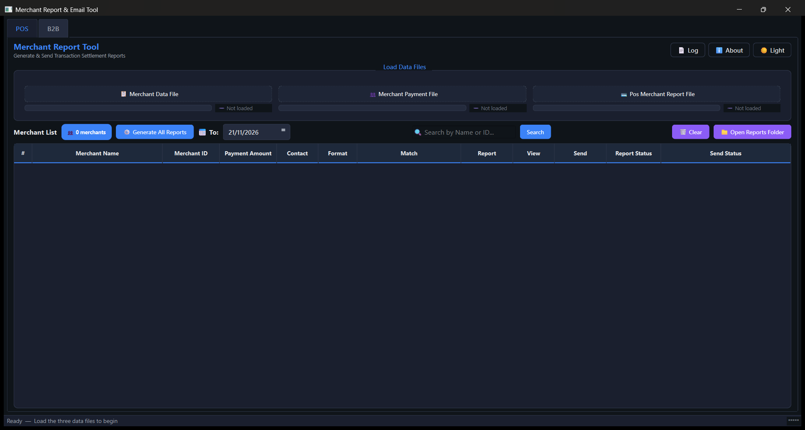

<h1 align="center">Merchant Report Tool v2.4</h1>

<p align="center"><b>B2B settlement verification and POS merchant reports with multi-channel delivery</b></p>

<p align="center">
  
  
  
  <a href="https://github.com/alisadhk/emil-report-mm/releases/latest"></a>
</p>

---

## Overview
A PyQt6 desktop application for finance and business-support teams. It merges and reconciles complex merchant data across **POS** and **B2B** operations, generates a formatted report for every merchant, and delivers it through Outlook or WhatsApp Web.

## Features
- Two workflows in one window: **POS** reports and **B2B** settlement verification
- Matching engine that reconciles settlement amounts with transaction logs (Match column)
- Batch processing: generate hundreds of formatted PDF and Excel reports in one run
- Smart archiving: reports are saved and labeled in a reports folder
- Interactive sending: Outlook and WhatsApp Web with pre-filled, merchant-specific message templates
- Dark and light themes, search by merchant name or ID, application log
- Reads contacts, payments and transactions from your own Excel/CSV files
- Auto-paste technology: opens the chat, attaches the report and inserts the message template

## How it works
- The tool loads the input files and builds the merchant table (name, ID, payment amount, contact, report format).
- For each merchant it matches the paid amount against the transaction log and flags differences in the **Match** column.
- It creates a formatted PDF or Excel report and stores it in the reports folder; *Report Status* shows progress.
- **Send** opens Outlook (COM) or WhatsApp Web, attaches the report and fills a template built from the merchant details; *Send Status* shows what is pending or done.

## Requirements
- Windows 10/11.
- Python 3.10+ with PyQt6, pandas, openpyxl, reportlab and pywin32 when running from source.
- Outlook desktop and/or WhatsApp Web for sending.
- Your own input files (no sample data is published).

## Screenshots
<p align="center"></p>
<p align="center"></p>

## Download and install
### Option A - Ready-to-run download (recommended)
1. Open the **[Releases page](https://github.com/alisadhk/emil-report-mm/releases/latest)**.
2. Download the file(s) listed under **Assets**:

| File | Size |
|---|---|
| `Merchant-Report-Tool.exe` | 78.6 MB |
| `Merchant-Report-Tool-archive.rar` | 78 MB |

3. Run it. 

### Option B - Run from source
Requirements: Windows 10/11 and Python 3.10+.

```bash
git clone https://github.com/alisadhk/emil-report-mm.git
cd emil-report-mm
python -m pip install -r requirements.txt
python merchant_report_tool.py
```

## How to use
1. Start the program with `python merchant_report_tool.py` or run the downloaded EXE.
2. Choose the **POS** or **B2B** tab.
3. POS tab: load the **Merchant Data File** (contacts and emails, .xlsx), the **Merchant Payment File** (.csv) and the **Pos Merchant Report File**; pick the **To** date.
4. B2B tab: load the **Merchant Info File**, the **Payment File** and the transactions file of your provider.
5. Check the **Merchant List**: the counter shows how many merchants were found and the **Match** column shows whether amounts reconcile.
6. Press **Generate All Reports** (or generate one merchant), open a report with **View**, then press **Send** to deliver it by Outlook or WhatsApp.
7. Use **Open Reports Folder** to see the files and **Log** to follow the run.

## Configuration and privacy
- All sensitive values from the original private version (passwords, tokens, license codes, user names, internal IP addresses, personal names and links) were replaced with `*****`.
- No customer data, reports or spreadsheets are included in this repository.

## Troubleshooting
- Merchant list stays empty: load all three files of the selected tab and keep the expected column names.
- Match shows differences: compare the payment file with the transaction log for that merchant.
- Nothing is sent: open Outlook once, or sign in to WhatsApp Web, then retry.

## Build the executable yourself
```bash
python -m pip install pyinstaller
python -m PyInstaller --noconfirm Merchant-Report-Tool.spec
```
The executable is created in the `dist/` folder.

## Notes
- Use only data you are authorized to process.
- Outlook sending uses the Outlook desktop app through COM (pywin32), so Outlook must be installed.

---

<p align="center">Maintained by <a href="https://github.com/alisadhk">@alisadhk</a> - last update 2026-05-11</p>